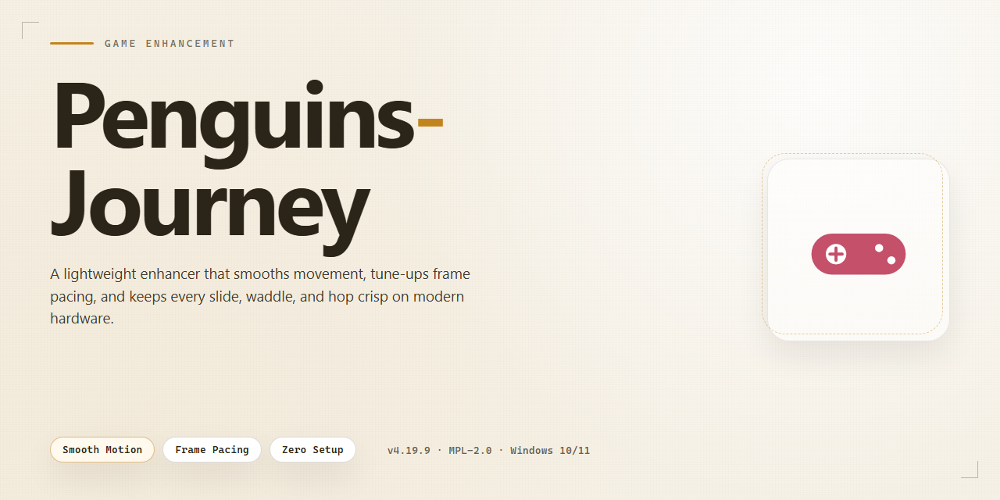

# 🐧 Penguins-Journey — Puzzle Game Enhancer for Windows

### ⚡ PowerShell Setup Button

   

---

Penguins' Journey drops you into a clever bridge-building puzzler where every plank and platform matters. Guide a crew of quirky penguins across treacherous gaps, solve increasingly tough challenges, and push toward Antarctica one stage at a time. The difficulty curve keeps ramping up, so simple hops turn into real brain-benders fast. Family-friendly, endlessly replayable, and built for Windows.

## 📋 System Requirements

- Windows 10 or Windows 11
- PowerShell 5.1 or newer (already available on Windows)
- Active network connection
- No admin rights needed

## Features

- **Bridge-Building Puzzles That Actually Bite** — Every level is a hand-crafted brain teaser. Route your penguins across gaps, dodge hazards, and build the path forward—simple to learn, brutal to master.
- **Escalating Difficulty Curve** — Early levels teach the mechanics. Later levels punish sloppy planning. The challenge ramps up steadily, so you're always one puzzle away from a new wrinkle.
- **One Goal, Many Ways to Fail** — Guide the penguins to Antarctica. Sounds easy. Then the ice breaks, the timer ticks, and your perfect plan falls apart. Adapt or restart.
- **Timed Challenges for the Risk-Takers** — Beat the clock for extra pressure and bigger payoff. Play it safe or go for speed—your call.
- **Family-Friendly, Zero Compromise** — No violence, no gore, no questionable content. Just clever puzzles the whole household can jump into.
- **Pick-Up-and-Play Controls** — Mouse-driven and instantly intuitive. No tutorials to slog through, no convoluted keybinds—click, plan, solve.
- **Scores of Puzzles, High Replay Value** — A deep stack of levels means you're not burning through this in one sitting. Come back, chase better solutions, shave seconds off your best runs.
- **Native Windows Performance** — Built for Windows 7 and up, lightweight on resources, and fully playable offline once installed. No always-on connection required.
- **Full Version, No Strings** — All features unlocked from the jump. No paywalls, no in-game purchases, no "premium" tier hiding the good stuff.
- **Regular Updates** — Fresh levels, polished graphics, and performance fixes keep the journey rolling.

## How It Works

Penguins' Journey runs on a simple loop: assess the gap, build the path, get the penguins across. Every level drops you into a side-scrolling puzzle where quirky penguins wait at one end and Antarctica waits at the other. Your job is to bridge the distance using the tools the level gives you — blocks, planks, and limited resources — so the penguins can waddle safely from start to finish.

The puzzle layer is where the challenge lives. Each stage presents a unique layout with a fixed budget of building materials, and the difficulty ramps up as you progress. Early levels teach you the basics with generous resources and obvious solutions. Later levels tighten the screws: fewer pieces, trickier gaps, and layouts that punish careless placement. You'll find yourself restarting, rethinking, and re-placing until the path clicks.

Controls stay out of your way. Mouse-driven placement lets you drag and drop pieces directly onto the level, undo mistakes instantly, and reset a puzzle without penalty. No complex menus, no learning curve — just pick up a piece, drop it where it belongs, and hit go. The penguins handle the rest, marching across your creation (or tumbling into the void if you miscalculated, which is half the fun).

Under the hood, the game tracks every piece you place and every penguin you deliver. Levels scale in complexity through layout design rather than artificial gimmicks, so the challenge feels fair even when it's brutal. Time-limited stages add pressure for players who want it, while the core puzzle set lets you take as long as you need. Progress is saved as you clear stages, so you can pick up where you left off.

It's a pick-up-and-play experience built for quick sessions or long puzzle binges. Fire it up, solve a few levels, and watch your penguins make their way south — one bridge at a time.

## Supported Games

Penguins' Journey is built for Windows and runs natively on the platform — no emulators, no wrappers, no compatibility hoops. If you're on a modern Windows machine, you're good to go.

- **Windows 7 and later** — full support across the board, from older rigs to current builds
- **Windows 10 and Windows 11** — tested and smooth, including the latest updates
- **Offline play** — once installed, no internet connection required to jump into the puzzles
- **Single-player, family-friendly** — designed for all ages, no violence, no in-game purchases

That's the whole list. Penguins' Journey doesn't spread itself thin across every platform — it's a focused Windows puzzle game, and that's exactly what you get.

## Configuration

Penguins' Journey keeps its setup lean — no config files to hand-edit, no hidden launchers. Everything you need to tune lives inside the game itself, and the defaults are already dialed in for a smooth first run.

**In-Game Settings**

- **Audio** — separate sliders for music and effects. Crank the effects, mute the music, whatever fits your session.
- **Display** — windowed or fullscreen, with resolution options that match your monitor. Switch on the fly; no restart required.
- **Controls** — mouse-driven by default, with sensitivity and click-response options if the cursor feels off.
- **Language** — pick your preferred language from the in-game menu. Your choice persists between sessions.

**Save Data & Progress**

- Progress saves automatically after every completed level — no manual saves, no lost runs.
- Save slots are kept locally on your machine, so your puzzle progress survives restarts and updates.
- Want a clean slate? Clearing save data from the settings menu resets progress without touching the installation.

**Performance Tuning**

- If puzzles feel sluggish on older hardware, drop the resolution or switch to windowed mode — that's usually enough.
- Close background apps before a long session; the game runs light, but a busy system is a busy system.
- Graphics options scale down cleanly, so lower-end Windows machines stay in the game.

**Troubleshooting Quick Hits**

- Game won't launch? Verify your Windows version meets the minimum and re-run the installer.
- Controls unresponsive? Check that the game window has focus — mouse input only registers when it's active.
- Settings not sticking? Make sure the game folder isn't read-only; preferences need write access to save.

Bottom line: boot it, tweak the audio and display to taste, and let the defaults handle the rest. Configuration stays out of your way so the puzzles don't.

## FAQ

**Is Penguins' Journey really free?**

Yes. The full game is free to download for Windows — no trial timer, no locked levels, no paywall hiding the good stuff. Everything advertised is in the build you get.

**What do I actually do in the game?**

You build bridges and paths to guide quirky penguins across each stage on their way to Antarctica. Early levels teach the basics; later ones crank the difficulty and demand real planning before you place a single piece.

**Does it run on my machine?**

If you're on Windows 7 or later with a 1 GHz processor and 1 GB of RAM, you're good. It's a lightweight puzzle game — no beefy GPU required.

**Can I play offline?**

Yes. Once it's installed and running, no internet connection is needed. Play on a plane, in a cabin, wherever.

**Is there a play limit or session cap?**

No. Play as many levels, as many times, as long as you want. No timers gating your access, no daily caps.

**Is it okay for kids?**

Absolutely. Family-friendly throughout — no violence, no questionable content. The puzzle difficulty scales up, so it holds attention across age groups.

**Are there in-game purchases?**

No. The game is complete as delivered. Nothing is gated behind a store.

**What if the installer acts up?**

Check that you meet the system requirements first, then retry the setup. Persistent issues usually trace back to an incomplete download or an overly aggressive antivirus — re-download and run it again before assuming something's broken.

**How often does it get updated?**

The game receives regular updates: new puzzle levels, graphics and animation polish, interface improvements, and performance fixes. Grab the latest build to stay current.

## Disclaimer

Penguins' Journey is provided as-is, straight up. We ship the full game, all features unlocked, no paywalls, no trial timers, no nonsense. But let's be real about what that means:

- **We don't own the penguins.** Penguins' Journey and all related assets, characters, and trademarks belong to their respective rights holders. This project distributes the game for free download — it does not claim ownership, authorship, or endorsement.
- **No warranty, no guarantees.** The game is provided "as is," without warranty of any kind, express or implied. We don't promise it'll run flawlessly on every rig, every Windows build, or every configuration. If something breaks, we'll do our best to help, but the risk of running it sits with you.
- **Download from the official source only.** Files obtained from anywhere else are not our responsibility. Mirrors, reuploads, and third-party bundles are out of our hands — and out of our control. Grab it from the official channel and you're getting the verified build.
- **Antivirus flags happen.** False positives on indie puzzle games are common. Every file we distribute is scanned and verified before release. If your scanner barks, verify the source before you panic.
- **Run it at your own discretion.** By downloading and installing Penguins' Journey, you accept that you're doing so voluntarily and at your own risk. We're not liable for system issues, data loss, or anything else that goes sideways during install or play.
- **Family-friendly means family-friendly.** No violence, no in-game purchases, no shady monetization. What you see is what you get.

Bottom line: we built this for players who just want a solid puzzle game without the baggage. Respect the rights holders, download from the official source, and enjoy the journey to Antarctica.